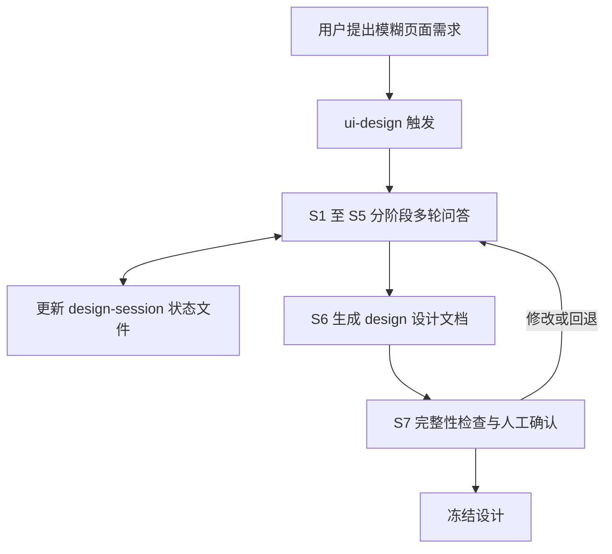

# 架构说明（ARCHITECTURE）

## 1. 定位

ui-design-workflow 是一套独立的、可跨 Agent 运行的页面设计工作流。它不是某个 AI 编程工具的插件集合：核心设计流程与 Agent 运行环境解耦，Skill 负责方法论，模板负责产物规范，适配层负责不同 Agent 的调用方式。

## 2. 三层架构

| 层 | 职责 | 内容 |
|---|---|---|
| Skill Layer 工作流层 | 执行设计方法论 | ui-design（设计）、ui-implement（实现，后续阶段）、ui-review（验收，后续阶段） |
| Specification Layer 规范层 | 定义产物与状态标准 | templates/（design.md、design-session.md、design-system.md）、schemas/（JSON Schema） |
| Adapter Layer 适配层 | 适配各 Agent 的调用入口、文件位置、工具能力和执行约束 | 安装映射、平台能力边界说明，不复制核心设计逻辑 |

## 3. 核心架构原则

| 原则 | 具体要求 |
|---|---|
| Agent 无关 | 核心 Skill 使用通用 Markdown 规范 |
| 文件交接 | 不依赖某个 Agent 的内部会话状态 |
| 设计可恢复 | 中断后通过 design-session.md 继续 |
| 设计可审计 | 记录每次重要设计决策（decisions + history） |
| 人工可控 | 设计冻结必须经过用户确认 |
| 技术无关 | 不限制最终生成 HTML、React 或 Vue |
| 知识可扩展 | 页面模式、图表模式、视觉风格在 references/ 独立维护 |

## 4. 数据流

关键数据流约定：

- **design-session.md 是唯一恢复点**：所有阶段状态、已确认决策、待确认问题、修改历史都在其中，新会话凭它继续，不依赖任何 Agent 的内部记忆。
- **design.md 是唯一交付物**：落在使用方的目标项目根目录，可直接交给开发 Agent（人或 ui-implement）实现。
- 决策状态机：`proposed`（AI 提议）→ `confirmed`（用户确认）→ 可变为 `superseded`（被新决策替代）；`pending` 表示等待用户回答。
- 阶段状态机：`DISCOVERY → STRUCTURE → VISUAL → INTERACTION → DATA → REVIEW → FROZEN`，允许回退；`frozen: true` 当且仅当用户明确确认。

## 5. 产物文件区分（不能混成一个文件）

| 文件 | 性质 | 保存位置 |
|---|---|---|
| design.md | 单个页面或项目的设计交付文档 | 目标项目根目录 |
| design-system.md | 可跨页面复用的视觉规范 | 目标项目（多页面时） |
| design-session.md | 当前设计任务的进度与决策记录 | 目标项目 `.ui-design/design-session.md` |

## 6. 文件写入规则

1. 首次生成 design.md 前检查目标文件是否存在
2. 如果已存在，不允许静默覆盖
3. 用户确认后才能覆盖或创建新版本
4. 修改设计时先更新 session，再更新 design.md
5. 冻结时记录冻结时间和设计版本
6. 用户要求重新设计时允许解除冻结

## 7. 目录职责

| 目录/文件 | 职责 |
|---|---|
| `skills/ui-design/SKILL.md` | Skill 核心执行逻辑（七阶段对话规则） |
| `skills/ui-design/references/` | 设计方法论，按需加载，不塞进 SKILL.md |
| `templates/` | 标准文档模板（产物规范） |
| `schemas/` | 状态与决策数据的机器校验标准 |
| `examples/` | 实际设计案例（Benchmark 输入与期望输出） |
| `tests/` | 自动化检查与 Benchmark |
| `docs/` | 读者向文档（兼容性说明等） |
| `dev-docs/` | 本仓库开发过程文档（需求、计划、进度、经验） |

## 8. 通用性约束（Skill 红线）

SKILL.md 与 references 中禁止出现：

- 某个平台独有的提问组件（如「调用 AskUserQuestion」这类写法）
- 某个平台独有的 Agent 调度接口
- 某个平台专属的文件路径变量
- 某个平台专属的工具调用语法

提问统一表述为：「向用户提出一个当前阶段最重要的问题，等待用户回答后再继续。」平台具备专用提问能力时，在适配层使用，不影响通用流程。

## 9. 适配策略

唯一源文件原则：`skills/` 下只维护一份 SKILL.md 和 references，不为每个 Agent 复制多份。

| 目标环境 | Skill 目录 |
|---|---|
| Claude Code | `.claude/skills/` |
| Codex | `.agents/skills/` |
| OpenCode | `.agents/skills/` |
| Pi 等 | 安装脚本或路径配置，按各自发现机制适配 |

各平台的加载差异与能力边界记录在 `docs/compatibility.md`（T6 产出）。

## 10. 阶段边界

- Phase 1（当前）：只做 ui-design，只生成 Markdown；交付标准 = 一份经过用户确认、可冻结的 design.md
- Phase 1 明确不做：HTML/代码生成、页面预览、Figma 集成、浏览器自动化、截图对比、自动改代码、多 Agent 并发
- 后续阶段：ui-implement（按 design.md 实现）、ui-review（按验收标准验收）
