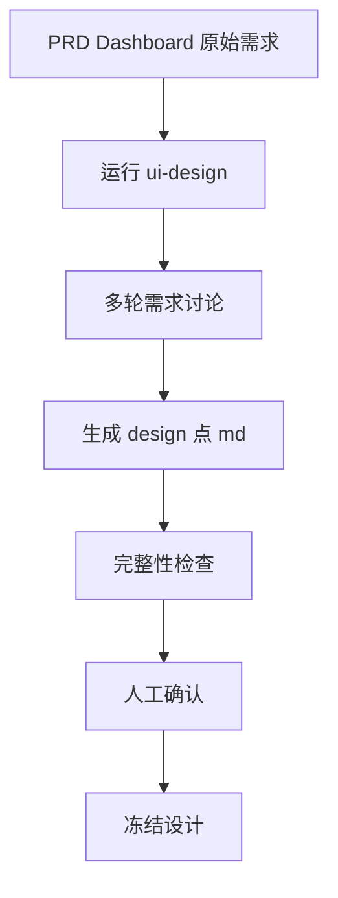

# UI Design Workflow — Phase 1 执行计划

- 版本：v1.0
- 日期：2026-11-11
- 项目：ui-design-workflow
- 目标仓库：https://github.com/mickorz/ui-design-workflow
- 开源协议：MIT
- 需求来源：[dev-docs/design/2026-11-11-phase1-ui-design-skill.md](../design/2026-11-11-phase1-ui-design-skill.md)

## 0. 锁定的工程决策

| 项目 | 最终决定 |
|---|---|
| 核心 Skill | `ui-design` |
| 交互模式 | 多轮对话 |
| 设计产物 | `design.md` |
| 保存位置 | 当前目标项目根目录（不是本仓库） |
| 预览能力 | 暂不支持 |
| 设计确认 | 人工确认后冻结 |
| 状态恢复 | `design-session.md` |
| Skill 规范 | 通用 Agent Skills |
| 开源协议 | MIT |

阶段目标：用户通过多轮对话描述页面需求，AI 逐步完成页面设计，最终在目标项目根目录生成一份经过人工确认的 design.md。第一阶段不生成 HTML，不生成页面原型，不负责前端实现。

设计产物落点示例：

```text
my-web-project/
├── design.md                 最终设计文档
├── .ui-design/
│   └── design-session.md     设计过程状态
├── src/
└── package.json
```

## 1. 阶段目标

建立一个通用、可跨 Agent 使用的 UI 页面设计 Skill。

用户通过多轮自然语言对话，逐步明确：

1. 页面目标和使用场景
2. 页面信息架构
3. 页面布局和内容层级
4. 视觉设计规范
5. 页面组件和交互方式
6. 数据来源与技术约束
7. 页面验收标准

最终生成经过人工确认的 design.md。

### 1.1 核心原则

- 设计优先，代码后置
- 多轮问答，不一次性生成全部设计
- 已确认的内容不重复询问
- 用户可以随时修改之前的决定
- 设计过程必须可恢复
- 未经用户确认，不允许冻结设计
- 核心 Skill 不依赖特定 Agent
- 第一阶段只生成 Markdown，不生成 HTML

### 1.2 第一阶段不包含

- HTML / React / Vue 页面生成
- 低保真或高保真页面预览
- Figma 集成
- 浏览器自动化
- 页面截图对比
- 自动修改前端代码
- 多 Agent 并发协作

## 2. 任务总览（6 个任务）

| 任务 | 名称 | 内容 | 优先级 |
|---|---|---|---|
| T1 | 仓库基础架构与开源规范 | 目录、README、架构说明、MIT License | P0 |
| T2 | 设计文档与状态文件标准 | design.md、design-session.md、Schema | P0 |
| T3 | ui-design 核心 Skill | 七阶段对话、决策管理、设计冻结 | P0 |
| T4 | 设计完整性检查 | 必填章节、未确认事项、状态一致性 | P0 |
| T5 | 真实案例验证 | PRD Quality Dashboard 作为 Benchmark | P1 |
| T6 | 跨 Agent 兼容性验证 | Claude Code、OpenCode、Codex、Pi | P1 |

## 3. T1：仓库基础架构与开源规范（P0）

### 3.1 目录结构

```text
ui-design-workflow/
├── README.md
├── LICENSE
├── AGENTS.md
├── ARCHITECTURE.md
├── skills/
│   └── ui-design/
│       ├── SKILL.md
│       └── references/
│           ├── discovery.md
│           ├── information-architecture.md
│           ├── visual-design.md
│           ├── interaction-design.md
│           └── design-review.md
├── templates/
│   ├── design.md
│   ├── design-session.md
│   └── design-system.md
├── schemas/
│   ├── design-session.schema.json
│   └── design-decision.schema.json
├── examples/
│   └── dashboard/
│       ├── input.md
│       ├── design.md
│       └── design-session.md
├── tests/
│   └── ui-design/
│       ├── cases/
│       ├── expected/
│       └── validate-design.py
└── docs/
    ├── compatibility.md
    └── phase-1-execution-plan.md
```

### 3.2 文件职责

| 文件 | 职责 |
|---|---|
| README.md | 项目介绍、安装、使用方法 |
| LICENSE | MIT 开源协议 |
| AGENTS.md | 仓库开发约定 |
| ARCHITECTURE.md | 整体架构 |
| SKILL.md | Skill 核心执行逻辑 |
| references/ | 设计方法论 |
| templates/ | 标准文档模板 |
| schemas/ | 状态及决策数据校验 |
| examples/ | 实际设计案例 |
| tests/ | 自动化检查与 Benchmark |

### 3.3 验收标准

- 目录结构建立
- MIT License 正确添加
- README 完整
- ARCHITECTURE 明确职责边界
- 核心 Skill 不依赖特定 Agent
- references 采用按需加载方式

## 4. T2：设计文档与状态文件标准（P0）

整个工作流最重要的基础。

### 4.1 design.md 标准（13 个章节）

1. 项目背景
2. 页面目标
3. 用户与使用场景
4. 信息架构
5. 页面布局
6. 内容与组件定义
7. 视觉设计规范
8. 交互设计
9. 数据结构与数据来源
10. 响应式设计
11. 技术约束
12. 页面验收标准
13. 设计决策记录

每个章节应明确：

- 已确认的设计内容
- 尚未确认的内容
- 必须实现的要求
- 可调整的设计建议
- 禁止擅自修改的约束

### 4.2 design-session.md 标准

记录当前设计任务的执行状态。保存位置：目标项目的 `.ui-design/design-session.md`。

必须包含：

- 项目基本信息
- 当前设计阶段
- 当前任务状态
- 已确认设计决定
- 待确认问题
- 被替代的旧决定
- 修改历史
- 设计文档生成状态
- 是否已冻结

### 4.3 设计决策记录格式

```yaml
decisions:
  - id: D-001
    category: layout
    description: 页面采用单页面纵向布局
    value: single-page
    status: confirmed
    source: user
```

决策状态：

| 状态 | 含义 |
|---|---|
| proposed | AI 提议 |
| confirmed | 用户确认 |
| pending | 等待确认 |
| superseded | 被新决定替代 |

### 4.4 设计阶段状态

统一使用：DISCOVERY、STRUCTURE、VISUAL、INTERACTION、DATA、REVIEW、FROZEN

### 4.5 文件写入规则

1. 首次生成 design.md 前检查目标文件是否存在
2. 如果已存在，不允许静默覆盖
3. 用户确认后才能覆盖或创建新版本
4. 修改设计时先更新 session，再更新 design.md
5. 冻结时记录冻结时间和设计版本
6. 用户要求重新设计时允许解除冻结

### 4.6 验收标准

- design.md 模板完整
- design-session.md 模板完整
- 决策状态符合约定
- Schema 校验正常
- 支持设计中断和恢复
- 支持修改历史
- 防止意外覆盖用户文件

## 5. T3：ui-design 核心 Skill（P0）

第一阶段的主要开发任务。Skill 文件：`skills/ui-design/SKILL.md`

### 5.1 Skill 元信息

采用 Agent Skills 基本格式：

```yaml
---
name: ui-design
description: 通过多轮对话理解页面需求，完成信息架构、布局、视觉、交互和数据设计，最终生成经过用户确认的 design.md。
---
```

### 5.2 触发场景

- 用户希望设计一个新页面
- 用户希望根据业务需求生成页面设计文档
- 用户希望优化已有页面的结构
- 用户提供参考网站或参考图片，希望分析并制定页面设计
- 用户希望先设计再开发，而不是直接生成代码

### 5.3 七阶段执行流程

| 阶段 | 讨论内容 | 输出 |
|---|---|---|
| S1 需求理解 | 项目背景、页面目标、目标用户、使用场景、输入资料、技术限制 | 需求理解摘要 |
| S2 信息架构 | 页面数量、页面组织方式、页面区域、内容层级、导航结构 | 页面结构方案 |
| S3 视觉设计 | 整体视觉风格、浅色或深色、色彩体系、字体、信息密度、卡片和布局风格 | 视觉设计规范 |
| S4 交互设计 | 页面组件、图表、筛选、搜索、弹窗、抽屉、操作反馈 | 交互设计规范 |
| S5 数据与技术约束 | 数据来源、数据结构、字段定义、统计口径、运行环境、技术限制、外部依赖 | 数据及技术规范 |
| S6 设计文档生成 | 将所有已确认的设计决策整理到 design.md，生成前执行完整性检查 | design.md |
| S7 设计确认与冻结 | 展示设计文档主要内容和待确认项，用户确认、修改、重议、回退或暂停 | 冻结的最终设计文档 |

S7 中用户可以：确认设计、修改某个章节、重新讨论某项决策、返回之前的设计阶段、暂停当前任务。只有用户明确确认后，才能标记为 FROZEN。

S6 不能擅自补齐未经用户确认的关键业务规则。

### 5.4 多轮问答规则

- 每轮优先提出一个核心问题
- 允许提供 2～4 个选项
- 支持用户自由回答
- 已确认的内容不得重复询问
- AI 应给出推荐方案和理由
- 设计修改时分析受影响的章节
- 每个阶段结束时进行阶段性总结

### 5.5 验收标准

- 能够识别页面设计需求
- 能够完成七阶段流程
- 能够进行多轮问答
- 不重复询问已确认内容
- 支持用户修改之前的决定
- 支持中断恢复
- 支持最终设计冻结
- 正确生成 design.md

## 6. T4：设计完整性检查（P0）

设计文档生成后必须进行独立检查。

### 6.1 结构完整性

- 必须章节是否存在
- 是否存在空章节
- 页面结构是否明确
- 页面组件是否有定义

### 6.2 决策完整性

- 是否存在关键待确认问题
- 是否将 AI 建议错误标记为用户确认
- 是否存在互相冲突的设计决定
- 是否存在未处理的历史决定

### 6.3 数据完整性

- 数据来源是否明确
- 字段定义是否明确
- 统计口径是否明确
- 是否存在无依据的数据

### 6.4 交互完整性

- 主要交互是否明确
- 触发条件是否明确
- 操作结果是否明确
- 异常情况是否有定义

### 6.5 输出完整性

生成检查结果：

```text
Design Validation Report

结构完整性：PASS
决策完整性：PASS
数据完整性：PASS
交互完整性：PASS

未确认事项：0

最终状态：READY_FOR_REVIEW
```

检查通过不代表自动冻结，最终冻结仍需用户确认。

## 7. T5：真实案例验证（P1）

采用 PRD Quality Dashboard 作为第一个真实案例。

### 7.1 输入（PRD Dashboard 原始需求）

- 单页面纵向 Dashboard
- 高层汇报型
- 现代简洁浅色风格
- 舒适型信息密度
- 图表、风险分析、TOP 5、完整问题清单
- 不包含裁决功能
- 最终生成 HTML 的设计规范

### 7.2 测试流程



### 7.3 对照评测

将新 Skill 生成的 design.md 与之前人工讨论得到的 dashboard-design.md 进行对照，重点检查：

- 需求是否遗漏
- 页面结构是否一致
- 视觉设计是否一致
- 图表是否遗漏
- 交互是否遗漏
- 数据约束是否完整
- 是否出现 AI 擅自增加的需求

原始设计方案作为参考，不要求新 Skill 机械复制，而是检查最终设计决策是否得到保留。

## 8. T6：跨 Agent 兼容性验证（P1）

核心 Skill 只维护一份，不允许复制四份不同版本。

| Agent | 验证内容 |
|---|---|
| Claude Code | Skill 发现、加载、执行 |
| OpenCode | Skill 发现、加载、执行 |
| Codex | Skill 发现、加载、执行 |
| Pi | 安装适配、加载和执行 |

检查项：

- SKILL.md 是否被正确发现
- references 是否能够按需读取
- 文件写入权限是否正常
- 是否能够保存 session
- 是否能够在新会话恢复
- 是否支持设计确认流程

各 Agent 的特殊目录或加载规则放在适配说明中。第一阶段只要求完成兼容性验证，不要求开发完整安装管理器。

## 9. 第一阶段最终验收标准

### Gate A：基础规范

- MIT License
- Agent Skills 基本规范
- 通用目录结构
- design.md 模板
- design-session.md 模板
- Schema 校验

### Gate B：对话设计

- 七阶段流程
- 多轮问答
- 单问题优先
- 已确认决策记忆
- 设计回退
- 中断恢复
- 人工冻结

### Gate C：文档质量

- 13 个标准章节
- 必须实现与建议区分
- 禁止修改项明确
- 待确认事项明确
- 数据与交互规范完整
- 设计决策可追溯

### Gate D：实战验证

- Dashboard 案例完整通过
- 生成结果与用户确认内容一致
- 不擅自增加业务需求
- 不丢失设计决策
- 可以交接给后续开发 Skill

### Gate E：兼容性

- Claude Code 加载通过
- OpenCode 加载通过
- Codex 加载通过
- Pi 适配验证通过

## 10. 第一阶段最终 DoD

当用户提供一份模糊的页面需求时：

1. AI 能够主动进入需求理解阶段
2. 通过多轮对话明确设计目标
3. 按照七个阶段逐步完成设计
4. 将设计过程保存在 `.ui-design/design-session.md`
5. 在目标项目根目录生成 design.md
6. 经过完整性检查
7. 用户确认后冻结设计
8. 新会话能够恢复并继续设计

第一阶段不以生成页面为完成标准，而以生成一份经过用户确认、可直接交给其他 Agent 实现的设计文档为完成标准。

## 11. 执行顺序建议

不按 T1、T2、T3 的文件数量机械推进，而是：

1. 先定义 design.md 模板
2. 再定义 design-session.md 和决策状态
3. 用 Dashboard 案例手动填充模板，验证结构
4. 根据验证结果编写 ui-design/SKILL.md
5. 最后补齐自动检查和跨 Agent 验证

先验证设计文档标准是否合理，再让 Skill 学会生成它。

## 12. 下一步

先执行 T1 + T2，不立刻写完整 Skill。基础协议五件套：

- `ARCHITECTURE.md`
- `templates/design.md`
- `templates/design-session.md`
- `schemas/design-session.schema.json`
- `schemas/design-decision.schema.json`

完成后提交到 mickorz/ui-design-workflow，再开始实现核心 ui-design Skill。
